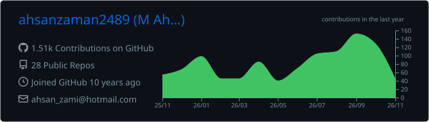
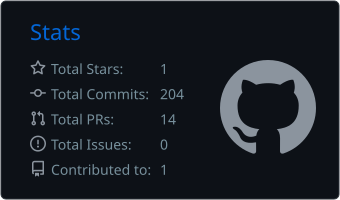
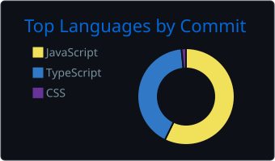

  <b>12+ years</b> building large-scale web and mobile products across the Gulf and globally, 
  including <b>Binance</b> and <b>Tradeling</b>. Currently leading frontend at <b>Krank Tech</b>, UAE.

  
  
  
  

---

### 🚀 What I do

- 🏗️ **Frontend architecture at scale.** Micro-frontends, SSR, and design systems used across whole product suites.
- 🤖 **Production AI.** RAG assistants, LLM integrations (OpenAI, Anthropic), AI agents, and real-time speech-to-structured-data workflows.
- 🎥 **Real-time systems.** WebRTC video and audio with recording, upload, retries, and resilient failure recovery.
- 👥 **Teams that ship.** Leading and mentoring engineers, and bridging product, design, backend, QA and DevOps.
- 📱 **Web and mobile.** React Native and Flutter apps alongside the web, sharing one design system.

### 🧰 Tech stack

   
  
  

  
  
  
  
  
  
  
  
  
  
  
  
  
  
  
  

### 💼 Where I've worked

| Company | Role | Years |
|---|---|---|
| **Krank Tech** | Lead Frontend Engineer / Team Lead | Dec 2024 – now |
| **Binance** | Senior Frontend, KYC platform | Mar 2022 – May 2024 |
| **Tradeling** | Front-end & Mobile Lead | Jan 2020 – Feb 2022 |
| **Eyewa** | Senior Front-end | Apr 2018 – Dec 2019 |
| **Etisalat** | Senior Front-end | Jun 2017 – Apr 2018 |
| **Creative Chaos** | Front-end | Oct 2013 – May 2017 |

🎓 **Bachelor of Computer Science (BSCS)**, Sindh University, 2009 – 2013

### 📊 GitHub activity

  

  
  

<picture>
  <source media="(prefers-color-scheme: dark)" srcset="https://raw.githubusercontent.com/ahsanzaman2489/ahsanzaman2489/output/github-snake-dark.svg" />
  
</picture>

---

💬 **Open to senior and lead frontend roles: remote, UAE, or relocation.** 
Let's build something people love using. [Get in touch →](https://ahsan-zaman.vercel.app/)

